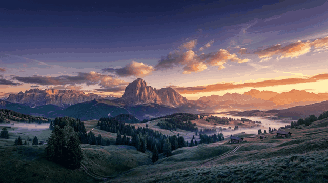

# TimeWall

[English](#english) | [日本語](#日本語)




*Illustration: the 9 sample images in order, one per second. In real use the switching follows sunrise/sunset. / イメージ動画です。実際の切り替えは、日の出・日の入りに合わせて行われます。*

---

## English

TimeWall is an original dynamic wallpaper system for KDE Plasma, inspired by macOS Dynamic Desktop. It changes the wallpaper of **each virtual desktop** by sunrise/sunset, a time schedule, or a slideshow. Not affiliated with Apple.

### Features

- Per-desktop settings (1-8 virtual desktops)
- 5 modes: off, fixed image, slideshow (3-60 min), time schedule (up to 100 images), sunrise/sunset (up to 100 images, in 5 sections)
- Gentle cross-fade or instant change, your choice (slideshow, time schedule, sunrise/sunset)
- Slideshow with **Auto** (the same images as the other modes) or **Manual** (its own folder), so one desktop can have two wallpaper sets
- Location from your system time zone (`auto`), a city name, or latitude/longitude
- Settings app (English / Japanese, follows the system language) with thumbnails and a motion preview (every 2 s, 2 rounds)
- Pause switch and per-desktop off switch

### Requirements

- KDE Plasma 6 (uses `qdbus6` and Plasma's scripting interface)
- Python 3 with `astral`, `Pillow` and `PyQt6`
- systemd (user units)

On Arch-based systems: `sudo pacman -S python-astral python-pillow python-pyqt6`

Developed and tested on pearOS NiceC0re only. Other setups are untested.

### Install

```
git clone https://github.com/machi-nao/timewall.git
cd timewall
./install.sh
```

The installer copies the files to `~/.local/...`, creates `~/Pictures/wp/desktop1` ... `desktop8`, installs a launcher ("TimeWall") and enables the timer. It does not need sudo. Existing files are kept as `name~`, and an existing `~/.config/timewall.json` is never overwritten.

### Updating from v1.x

```
cd timewall
git pull
./install.sh
```

- Your settings (`~/.config/timewall.json`) are kept. A dated backup is made first (`timewall.json.bak-YYYYMMDD-HHMMSS`).
- Existing desktops keep working as they are. The new options (5 sunrise/sunset sections, slideshow Auto/Manual, fade for the slideshow) stay off until you choose them in the settings app.
- Replaced program files are kept as `name~` next to the new ones.
- To go back to the old version: `git checkout v1.0.0 && ./install.sh` (use `git checkout main` to return).

### Quick start

1. Put images into `~/Pictures/wp/desktop1/` (see the naming rules below).
2. Open **TimeWall** from the app launcher.
3. In the "Desktop 1" tab choose a mode, then press **Save and apply**.

### Images

- Put them in `~/Pictures/wp/desktopN/` (N = desktop number). You can change the folder per desktop.
- Formats: `.jpg`, `.jpeg`, `.png`, `.webp`.
- Images are used **in file name order**. Number them: `01_morning.jpg`, `02_noon.jpg`, `03_evening.jpg`, `04_night.jpg`.
- Up to **100 images** per folder (per section in sunrise/sunset mode). More images make the flow of time smoother, so put plenty in the hours you actually use your PC (early morning, daytime, evening, late night).
- For cross-fade, use images with the same resolution and aspect ratio. The next image is resized to the size of the previous one.
- Sample images are in `examples/images/` (generated with Google Gemini, not covered by the MIT license). To try the app quickly: `cp examples/images/*.jpg ~/Pictures/wp/desktop1/`

### Modes

| Mode | What it does |
|---|---|
| `off` | TimeWall does not touch this desktop |
| `static` | One fixed image (`image`) |
| `slideshow` | Cycles through images every `minutes` (3-60). `slideshow_source`: `auto` (default: the images of `desktopN`, including its sub-folders) or `manual` (the folder `slideshow_dir`, default `desktopN-slideshow`). Optional `fade` |
| `schedule` | Switches at the times in `times` (`"HH:MM"`, up to 100), in image order. Optional `fade` |
| `sunpath` | Sunrise/sunset mode. Put images in the sub-folders `1_before_sunrise`, `2_sunrise`, `3_day`, `4_sunset`, `5_after_sunset` (any section may be empty; an empty section keeps showing the previous image). Each section's images are spread evenly over its time. `twilight_min` (default 30) is the width around sunrise and sunset. Without sub-folders it works as before: a day group and a night group (`day_count`). Optional `fade` |

### Location

`location` in the config can be:

- `"auto"`: uses the representative city of the system time zone (it is not your exact position)
- a city name known to the `astral` library, e.g. `"Tokyo"`, `"Paris"`
- `{"lat": 35.68, "lon": 139.76}`

### Config file

`~/.config/timewall.json` (an example is in `examples/timewall.json`). You normally edit it through the app.

```json
{
  "location": "auto",
  "language": "auto",
  "hello_sync": false,
  "paused": false,
  "aerial": {"dir": "~/Videos/aerial", "mode": "same"},
  "desktops": {
    "1": {"mode": "sunpath", "dir": "~/Pictures/wp/desktop1", "fade": true, "twilight_min": 30},
    "2": {"mode": "slideshow", "dir": "~/Pictures/wp/desktop2", "minutes": 10, "fade": true, "slideshow_source": "auto"},
    "3": {"mode": "slideshow", "dir": "~/Pictures/wp/desktop3", "minutes": 10, "slideshow_source": "manual", "slideshow_dir": "~/Pictures/wp/desktop3-slideshow"},
    "4": {"mode": "schedule", "dir": "~/Pictures/wp/desktop4", "times": ["07:00", "17:00", "19:00"], "fade": true},
    "5": {"mode": "off"}
  }
}
````

`language`: `auto` (system), `ja` or `en`. `paused: true` stops everything.

### Optional: sync with the "hello" boot screen

TimeWall can copy the current wallpaper to `/usr/local/share/hello-wallpaper.jpg` so a boot/login screen can show the same wallpaper. This only works if you have set up the "hello" screen described here: https://github.com/orgs/pearOS-archlinux/discussions/140
Then set `"hello_sync": true`. If that file does not exist, nothing happens.

### Aerial (lock screen video) — pearOS NiceC0re only

Aerial plays a video on the lock screen and keeps the frozen frame as your wallpaper after you unlock.

**Install** (patches the lock screen file; sudo is asked only when needed):

```
cd extras/aerial-lockscreen
./install-aerial.sh
```

- Made for **pearOS NiceC0re** (tested with plasma-desktop 6.8.1-1). The script checks that your lock screen file matches the one the patch was made for. If it does not, **nothing is changed**.
- A backup is saved next to the file (`LockScreenUi.qml.pre-aerial`). To go back: `./uninstall-aerial.sh`.
- A system update of plasma-desktop can overwrite the patched file. If the video stops showing, run `./install-aerial.sh` again.
- It also installs a small watcher service that hands the frozen frame over to the wallpaper after unlock.

**Videos**

Use any video you like, such as your own time-lapse footage or videos generated with AI. Put them in `~/Videos/aerial` (mp4, webm, mkv and mov are supported) and choose one per desktop in TimeWall.

Recommended: about **720p** and **no audio**. To convert a video with `ffmpeg` (`sudo pacman -S ffmpeg`):

```
ffmpeg -i input.mp4 -an -vf "scale=-2:'min(720,ih)'" -c:v libx264 -crf 23 -preset medium -movflags +faststart ~/Videos/aerial/output.mp4
```

If you are not sure how, ask an AI assistant such as Claude to write the command for you.

**After unlock**

In the settings app, "Wallpaper after unlock" lets you choose between the frozen Aerial frame and your normal TimeWall image. The frozen frame stays for at least 10 minutes and is replaced when TimeWall changes the picture.

### Backup / uninstall

```
./backup.sh                 # saves settings to ~/Backups (add --with-images to include ~/Pictures/wp)
./uninstall.sh              # removes the program, keeps your images and config
./uninstall.sh --purge      # also removes ~/.config/timewall.json
```

Restore a backup with `tar xzf <file> -C /` and then `systemctl --user daemon-reload`.

### How it works

A systemd timer runs `timewall.py` every minute, and a small watcher runs it again when you switch virtual desktops. The wallpaper is set through Plasma's scripting interface over D-Bus. Cross-fade images are cached in `~/.cache/timewall`.

### Known limitations

- Aerial (the lock screen video) is made for pearOS NiceC0re only. In the settings app, the Aerial and "wallpaper after unlock" options appear only when the lock screen patch is installed, and the lock chime option only on pearOS.
- Only the desktop you are currently on is updated. Other desktops update when you switch to them.
- Plasma updates may change the scripting interface and break the wallpaper change.
- Changing the number of desktops from the app is experimental.
- `install.sh` was tested on a second pearOS NiceC0re USB (fresh clone from GitHub). Other distributions are untested.

### Images

The images in `examples/images/` were generated with Google Gemini. They are not covered by this repository's MIT license; please follow the terms of the service that generated them.

### License

MIT, see `LICENSE`.

---

## 日本語

TimeWall は、macOS のダイナミックデスクトップに着想を得た、KDE Plasma 用のオリジナル壁紙システムです。**仮想デスクトップごと**に、日の出・日の入り、時刻、スライドショーで壁紙を切り替えます。Apple とは関係ありません。

### 特徴

- デスクトップごとの設定(仮想デスクトップ 1〜8)
- 5つのモード: 停止、固定、スライドショー(3〜60分)、時刻指定(最大100枚)、日の出・日の入り連動(最大100枚・5つの区間)
- ゆるやかなフェード、または瞬時の切り替えを選べます(スライドショー、時刻指定、日の出・日の入り連動)
- スライドショーは、**自動**(他のモードと同じ画像)と**手動**(専用フォルダ)から選べるので、1つのデスクトップに2種類の壁紙を設定できます
- 場所は、システムのタイムゾーン(`auto`)、都市名、緯度・経度から選べます
- 設定画面(日本語・英語、システムの言語に連動)。サムネイル表示と、動きの確認(2秒ごと・2周)つき
- 全体の一時停止と、デスクトップごとの停止

### 必要なもの

- KDE Plasma 6(`qdbus6` と Plasma のスクリプト機能を使います)
- Python 3 と `astral`、`Pillow`、`PyQt6`
- systemd(ユーザーユニット)

Arch系: `sudo pacman -S python-astral python-pillow python-pyqt6`

pearOS NiceC0re でのみ、開発と動作確認をしています。ほかの環境は未確認です。

### インストール

```
git clone https://github.com/machi-nao/timewall.git
cd timewall
./install.sh
```

ファイルを `~/.local/...` にコピーし、`~/Pictures/wp/desktop1` 〜 `desktop8` を作り、ランチャー(「TimeWall」)を登録して、タイマーを有効にします。sudo は不要です。すでにあるファイルは `名前~` として残り、既存の `~/.config/timewall.json` は上書きされません。

### v1.x からの更新

```
cd timewall
git pull
./install.sh
```

- 設定(`~/.config/timewall.json`)は、そのまま残ります。先に、日付つきのバックアップを作ります(`timewall.json.bak-YYYYMMDD-HHMMSS`)。
- 今あるデスクトップは、これまでどおり動きます。新しい機能(日の出・日の入りの5区間、スライドショーの自動・手動、スライドショーのフェード)は、設定アプリで選ぶまで、オフのままです。
- 入れ替えたプログラムは、新しいファイルの隣に `名前~` として残ります。
- 古い版に戻すには、`git checkout v1.0.0 && ./install.sh` を実行します(戻るときは `git checkout main`)。

### はじめかた

1. 画像を `~/Pictures/wp/desktop1/` に入れます(下の名前の付け方を参照)。
2. アプリランチャーから **TimeWall** を開きます。
3. 「デスクトップ 1」のタブでモードを選び、**保存して適用**を押します。

### 画像について

- 置き場所は `~/Pictures/wp/desktopN/`(N はデスクトップの番号)です。デスクトップごとにフォルダを変えることもできます。
- 形式は `.jpg`、`.jpeg`、`.png`、`.webp` です。
- 画像は**ファイル名の順**に使います。番号を付けてください: `01_morning.jpg`、`02_noon.jpg`、`03_evening.jpg`、`04_night.jpg`
- 1つのフォルダに、最大**100枚**まで入れられます(日の出・日の入り連動では、区間ごとに100枚)。枚数が多いほど、時間の流れがなめらかになるので、PCをよく使う時間帯(未明、日中、夜間、深夜など)に多くの画像を入れてください。
- フェードを使うなら、解像度と縦横比が同じ画像にしてください。次の画像は、前の画像の大きさに合わせて縮められます。
- サンプル画像を `examples/images/` に入れています(Google の Gemini で生成。MIT ライセンスの対象外です)。試すときは、`cp examples/images/*.jpg ~/Pictures/wp/desktop1/` でコピーしてください。

### モード

| モード | 動き |
|---|---|
| `off` | このデスクトップの壁紙には触りません |
| `static` | 1枚を固定します(`image`) |
| `slideshow` | 画像を、`minutes`(3〜60)ごとに順に切り替えます。`slideshow_source` は、`auto`(初期値。`desktopN` の画像を、サブフォルダの中も含めて使います)か、`manual`(`slideshow_dir` のフォルダ。初期値は `desktopN-slideshow`)です。`fade` は任意です |
| `schedule` | `times`(`"HH:MM"`、最大100個)の時刻に、画像の順に切り替えます。`fade` は任意です |
| `sunpath` | 日の出・日の入り連動です。画像を、サブフォルダ `1_before_sunrise`、`2_sunrise`、`3_day`、`4_sunset`、`5_after_sunset` に入れます(どの区間も空でかまいません。空の区間は、前の画像を続けます)。各区間の画像は、その区間の時間を均等に割って切り替わります。`twilight_min`(初期値30)は、日の出・日の入りの前後の幅です。サブフォルダがないときは、これまでどおり、日中のグループと夜のグループに分けます(`day_count`)。`fade` は任意です |

### 場所

設定の `location` には、次を指定できます。

- `"auto"`: システムのタイムゾーンの代表都市を使います(正確な現在地ではありません)
- `astral` ライブラリが知っている都市名(例: `"Tokyo"`、`"Paris"`)
- `{"lat": 35.68, "lon": 139.76}`

### 設定ファイル

`~/.config/timewall.json` です(例は `examples/timewall.json`)。ふだんは、アプリから編集します。書式は、英語の説明の例と同じです。

`language` は `auto`(システムに合わせる)、`ja`、`en` です。`paused: true` にすると、すべて止まります。

### 任意: 「hello」起動画面との連動

TimeWall は、いまの壁紙を `/usr/local/share/hello-wallpaper.jpg` にコピーできます。起動・ログイン画面に、同じ壁紙を出すためのものです。次の投稿で紹介している「hello」の画面を、先に設定した人だけが使えます: https://github.com/orgs/pearOS-archlinux/discussions/140
その場合は、`"hello_sync": true` にしてください。このファイルがないときは、何も起きません。

### Aerial(ロック画面の動画)— pearOS NiceC0re 専用

Aerial は、ロック画面で動画を流し、解除したあとも、止めたフレームを壁紙として残します。

**インストール**(ロック画面のファイルにパッチを当てます。sudo は、必要なときだけ聞かれます)

```
cd extras/aerial-lockscreen
./install-aerial.sh
```

- **pearOS NiceC0re** 用です(plasma-desktop 6.8.1-1 で確認しています)。ロック画面のファイルが、パッチの元のものと違うときは、**何も変えずに止まります**。
- 元のファイルは、同じ場所にバックアップされます(`LockScreenUi.qml.pre-aerial`)。元に戻すには、`./uninstall-aerial.sh` を実行します。
- plasma-desktop の更新で、パッチを当てたファイルが上書きされることがあります。動画が出なくなったら、もう一度 `./install-aerial.sh` を実行してください。
- 解除後に、止めたフレームを壁紙に引き継ぐ、小さな監視サービスも、一緒に入ります。

**動画について**

お好みの動画を使えます。自作のタイムラプス動画や、AIで作った動画も使えます。`~/Videos/aerial` に入れて(mp4、webm、mkv、mov に対応)、TimeWall で、デスクトップごとに選びます。

おすすめは、**720p** 程度で、**音声なし**です。`ffmpeg`(`sudo pacman -S ffmpeg`)で変換できます。

```
ffmpeg -i input.mp4 -an -vf "scale=-2:'min(720,ih)'" -c:v libx264 -crf 23 -preset medium -movflags +faststart ~/Videos/aerial/output.mp4
```

やり方が分からないときは、Claude などのAIに、コマンドを書いてもらってください。

**解除したあと**

設定アプリの「解除後の壁紙」で、Aerial で止めたフレームと、通常の TimeWall の壁紙を、選べます。止めたフレームは、少なくとも10分は残り、TimeWall が画像を切り替えたときに、置き換わります。

### バックアップ・アンインストール

```
./backup.sh                 # 設定を ~/Backups に保存(--with-images で ~/Pictures/wp も含める)
./uninstall.sh              # プログラムを削除(画像と設定は残す)
./uninstall.sh --purge      # ~/.config/timewall.json も削除
```

復元は、`tar xzf <ファイル> -C /` のあと、`systemctl --user daemon-reload` を実行します。

### しくみ

systemd のタイマーが、1分ごとに `timewall.py` を実行します。仮想デスクトップを切り替えたときは、小さな監視プログラムが、もう一度実行します。壁紙は、Plasma のスクリプト機能を、D-Bus 経由で呼んで設定します。フェードの中間画像は、`~/.cache/timewall` に保存されます。

### 既知の制限

- Aerial(ロック画面の動画)は、pearOS NiceC0re 専用です。設定アプリの Aerial と「解除後の壁紙」の項目は、ロック画面のパッチを入れたときだけ表示され、ロックチャイムの項目は pearOS でだけ表示されます。
- 更新されるのは、いま表示しているデスクトップだけです。ほかのデスクトップは、切り替えたときに更新されます。
- Plasma のアップデートで、スクリプト機能が変わると、壁紙の変更が動かなくなる可能性があります。
- アプリからデスクトップの数を変える機能は、実験的です。
- `install.sh` は、別の pearOS NiceC0re の USB で、GitHub から取得して動作を確認しました。ほかのディストリビューションは未確認です。

### 画像について

`examples/images/` の画像は、Google の Gemini を使って生成したものです。本リポジトリの MIT ライセンスは、これらの画像には適用されません。生成したサービスの利用規約に従ってください。

### ライセンス

MIT です。`LICENSE` を参照してください。


