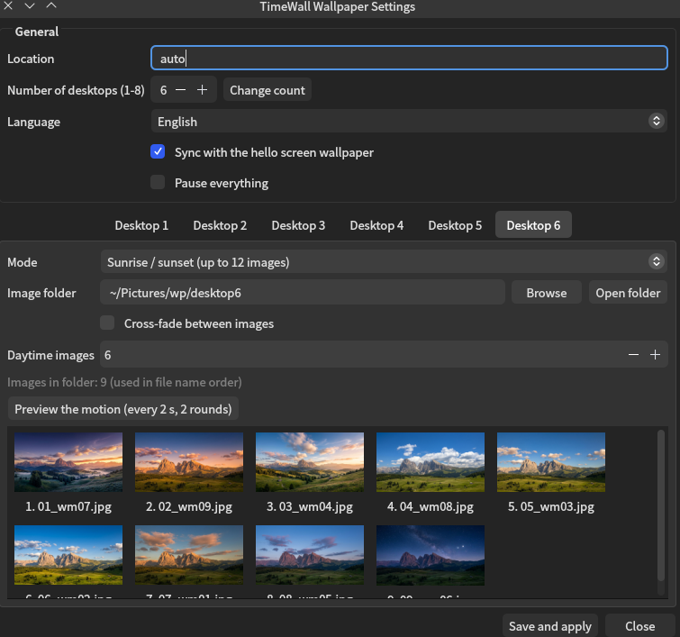
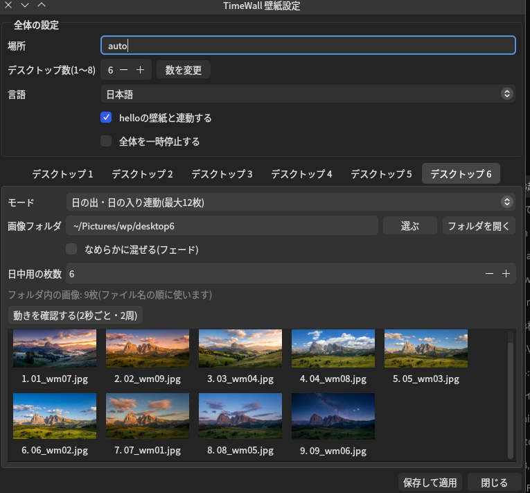

# TimeWall

[English](#english) | [日本語](#日本語)




---

## English

TimeWall is an original dynamic wallpaper system for KDE Plasma, inspired by macOS Dynamic Desktop. It changes the wallpaper of **each virtual desktop** by sunrise/sunset, a time schedule, or a slideshow. Not affiliated with Apple.

### Features

- Per-desktop settings (1-8 virtual desktops)
- 5 modes: off, fixed image, slideshow (3-60 min), time schedule (up to 12 images), sunrise/sunset (up to 12 images)
- Optional cross-fade between images
- Location from your system time zone (`auto`), a city name, or latitude/longitude
- Settings app (English / Japanese, follows the system language) with thumbnails and a motion preview (every 2 s, 2 rounds)
- Pause switch and per-desktop off switch

### Requirements

- KDE Plasma 6 (uses `qdbus6` and Plasma's scripting interface)
- Python 3 with `astral`, `Pillow` and `PyQt6`
- systemd (user units)

On Arch-based systems: `sudo pacman -S python-astral python-pillow python-pyqt6`

Developed and tested on pearOS NiceC0re only. Other setups are untested.

### Install

```
git clone https://github.com/machi-nao/timewall.git
cd timewall
./install.sh
```

The installer copies the files to `~/.local/...`, creates `~/Pictures/wp/desktop1` ... `desktop8`, installs a launcher ("TimeWall") and enables the timer. It does not need sudo. Existing files are kept as `name~`, and an existing `~/.config/timewall.json` is never overwritten.

### Quick start

1. Put images into `~/Pictures/wp/desktop1/` (see the naming rules below).
2. Open **TimeWall** from the app launcher.
3. In the "Desktop 1" tab choose a mode, then press **Save and apply**.

### Images

- Put them in `~/Pictures/wp/desktopN/` (N = desktop number). You can change the folder per desktop.
- Formats: `.jpg`, `.jpeg`, `.png`, `.webp`.
- Images are used **in file name order**. Number them: `01_morning.jpg`, `02_noon.jpg`, `03_evening.jpg`, `04_night.jpg`.
- Time schedule and sunrise/sunset modes use at most 12 images.
- For cross-fade, use images with the same resolution and aspect ratio. The next image is resized to the size of the previous one.
- Sample images are in `examples/images/` (generated with Google Gemini, not covered by the MIT license). To try the app quickly: `cp examples/images/*.jpg ~/Pictures/wp/desktop1/`

### Modes

| Mode | What it does |
|---|---|
| `off` | TimeWall does not touch this desktop |
| `static` | One fixed image (`image`) |
| `slideshow` | Cycles through the folder every `minutes` (3-60) |
| `schedule` | Switches at the times in `times` (`"HH:MM"`, up to 12), in image order. Optional `fade` |
| `sunpath` | Splits the images into a daytime group and a night group. Daytime images are spread evenly from sunrise to sunset, night images from sunset to the next sunrise. `day_count` sets how many images are daytime (omit it to decide from the day/night length). Optional `fade` |

### Location

`location` in the config can be:

- `"auto"`: uses the representative city of the system time zone (it is not your exact position)
- a city name known to the `astral` library, e.g. `"Tokyo"`, `"Paris"`
- `{"lat": 35.68, "lon": 139.76}`

### Config file

`~/.config/timewall.json` (an example is in `examples/timewall.json`). You normally edit it through the app.

```json
{
  "location": "auto",
  "language": "auto",
  "hello_sync": false,
  "paused": false,
  "desktops": {
    "1": {"mode": "sunpath", "dir": "~/Pictures/wp/desktop1", "fade": true},
    "2": {"mode": "slideshow", "dir": "~/Pictures/wp/desktop2", "minutes": 10},
    "3": {"mode": "off"}
  }
}
```

`language`: `auto` (system), `ja` or `en`. `paused: true` stops everything.

### Optional: sync with the "hello" boot screen

TimeWall can copy the current wallpaper to `/usr/local/share/hello-wallpaper.jpg` so a boot/login screen can show the same wallpaper. This only works if you have set up the "hello" screen described here: https://github.com/orgs/pearOS-archlinux/discussions/140
Then set `"hello_sync": true`. If that file does not exist, nothing happens.

### Backup / uninstall

```
./backup.sh                 # saves settings to ~/Backups (add --with-images to include ~/Pictures/wp)
./uninstall.sh              # removes the program, keeps your images and config
./uninstall.sh --purge      # also removes ~/.config/timewall.json
```

Restore a backup with `tar xzf <file> -C /` and then `systemctl --user daemon-reload`.

### How it works

A systemd timer runs `timewall.py` every minute, and a small watcher runs it again when you switch virtual desktops. The wallpaper is set through Plasma's scripting interface over D-Bus. Cross-fade images are cached in `~/.cache/timewall`.

### Known limitations

- Only the desktop you are currently on is updated. Other desktops update when you switch to them.
- Plasma updates may change the scripting interface and break the wallpaper change.
- Changing the number of desktops from the app is experimental.
- `install.sh` has not yet been tested on a clean system.

### Images

The images in `examples/images/` were generated with Google Gemini. They are not covered by this repository's MIT license; please follow the terms of the service that generated them.

### License

MIT, see `LICENSE`.

---

## 日本語

TimeWall は、macOS のダイナミックデスクトップに着想を得た、KDE Plasma 用のオリジナル壁紙システムです。**仮想デスクトップごと**に、日の出・日の入り、時刻、スライドショーで壁紙を切り替えます。Apple とは関係ありません。

### 特徴

- デスクトップごとの設定(仮想デスクトップ 1〜8)
- 5つのモード: 停止、固定、スライドショー(3〜60分)、時刻指定(最大12枚)、日の出・日の入り連動(最大12枚)
- 画像同士のなめらかなフェード(任意)
- 場所は、システムのタイムゾーン(`auto`)、都市名、緯度・経度から選べます
- 設定画面(日本語・英語、システムの言語に連動)。サムネイル表示と、動きの確認(2秒ごと・2周)つき
- 全体の一時停止と、デスクトップごとの停止

### 必要なもの

- KDE Plasma 6(`qdbus6` と Plasma のスクリプト機能を使います)
- Python 3 と `astral`、`Pillow`、`PyQt6`
- systemd(ユーザーユニット)

Arch系: `sudo pacman -S python-astral python-pillow python-pyqt6`

pearOS NiceC0re でのみ、開発と動作確認をしています。ほかの環境は未確認です。

### インストール

```
git clone https://github.com/machi-nao/timewall.git
cd timewall
./install.sh
```

ファイルを `~/.local/...` にコピーし、`~/Pictures/wp/desktop1` 〜 `desktop8` を作り、ランチャー(「TimeWall」)を登録して、タイマーを有効にします。sudo は不要です。すでにあるファイルは `名前~` として残り、既存の `~/.config/timewall.json` は上書きされません。

### はじめかた

1. 画像を `~/Pictures/wp/desktop1/` に入れます(下の名前の付け方を参照)。
2. アプリランチャーから **TimeWall** を開きます。
3. 「デスクトップ 1」のタブでモードを選び、**保存して適用**を押します。

### 画像について

- 置き場所は `~/Pictures/wp/desktopN/`(N はデスクトップの番号)です。デスクトップごとにフォルダを変えることもできます。
- 形式は `.jpg`、`.jpeg`、`.png`、`.webp` です。
- 画像は**ファイル名の順**に使います。番号を付けてください: `01_morning.jpg`、`02_noon.jpg`、`03_evening.jpg`、`04_night.jpg`
- 時刻指定と日の出・日の入り連動では、最大12枚まで使います。
- フェードを使うなら、解像度と縦横比が同じ画像にしてください。次の画像は、前の画像の大きさに合わせて縮められます。
- サンプル画像を `examples/images/` に入れています(Google の Gemini で生成。MIT ライセンスの対象外です)。試すときは、`cp examples/images/*.jpg ~/Pictures/wp/desktop1/` でコピーしてください。

### モード

| モード | 動き |
|---|---|
| `off` | このデスクトップの壁紙には触りません |
| `static` | 1枚を固定します(`image`) |
| `slideshow` | フォルダの画像を、`minutes`(3〜60)ごとに順に切り替えます |
| `schedule` | `times`(`"HH:MM"`、最大12個)の時刻に、画像の順に切り替えます。`fade` は任意です |
| `sunpath` | 画像を、日中のグループと夜のグループに分けます。日中の画像は日の出から日の入りまで、夜の画像は日の入りから次の日の出まで、均等に割り当てます。`day_count` で日中の枚数を決めます(省略すると、昼夜の長さで決めます)。`fade` は任意です |

### 場所

設定の `location` には、次を指定できます。

- `"auto"`: システムのタイムゾーンの代表都市を使います(正確な現在地ではありません)
- `astral` ライブラリが知っている都市名(例: `"Tokyo"`、`"Paris"`)
- `{"lat": 35.68, "lon": 139.76}`

### 設定ファイル

`~/.config/timewall.json` です(例は `examples/timewall.json`)。ふだんは、アプリから編集します。書式は、英語の説明の例と同じです。

`language` は `auto`(システムに合わせる)、`ja`、`en` です。`paused: true` にすると、すべて止まります。

### 任意: 「hello」起動画面との連動

TimeWall は、いまの壁紙を `/usr/local/share/hello-wallpaper.jpg` にコピーできます。起動・ログイン画面に、同じ壁紙を出すためのものです。次の投稿で紹介している「hello」の画面を、先に設定した人だけが使えます: https://github.com/orgs/pearOS-archlinux/discussions/140
その場合は、`"hello_sync": true` にしてください。このファイルがないときは、何も起きません。

### バックアップ・アンインストール

```
./backup.sh                 # 設定を ~/Backups に保存(--with-images で ~/Pictures/wp も含める)
./uninstall.sh              # プログラムを削除(画像と設定は残す)
./uninstall.sh --purge      # ~/.config/timewall.json も削除
```

復元は、`tar xzf <ファイル> -C /` のあと、`systemctl --user daemon-reload` を実行します。

### しくみ

systemd のタイマーが、1分ごとに `timewall.py` を実行します。仮想デスクトップを切り替えたときは、小さな監視プログラムが、もう一度実行します。壁紙は、Plasma のスクリプト機能を、D-Bus 経由で呼んで設定します。フェードの中間画像は、`~/.cache/timewall` に保存されます。

### 既知の制限

- 更新されるのは、いま表示しているデスクトップだけです。ほかのデスクトップは、切り替えたときに更新されます。
- Plasma のアップデートで、スクリプト機能が変わると、壁紙の変更が動かなくなる可能性があります。
- アプリからデスクトップの数を変える機能は、実験的です。
- `install.sh` は、まっさらな環境では、まだ試していません。

### 画像について

`examples/images/` の画像は、Google の Gemini を使って生成したものです。本リポジトリの MIT ライセンスは、これらの画像には適用されません。生成したサービスの利用規約に従ってください。

### ライセンス

MIT です。`LICENSE` を参照してください。


